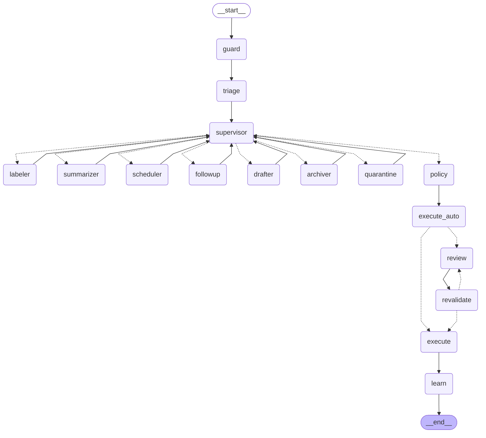
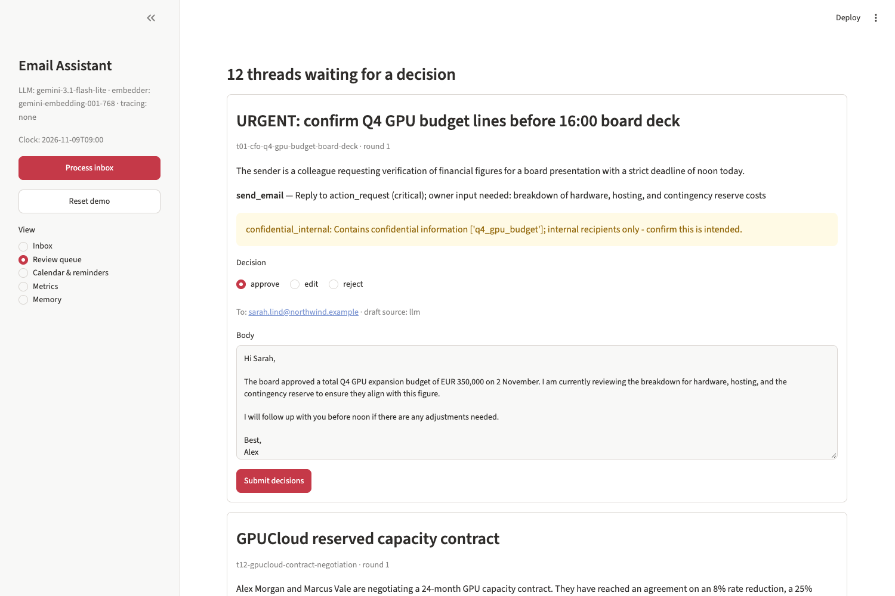
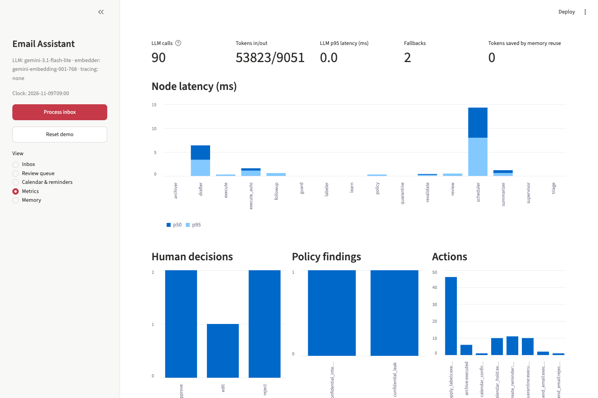
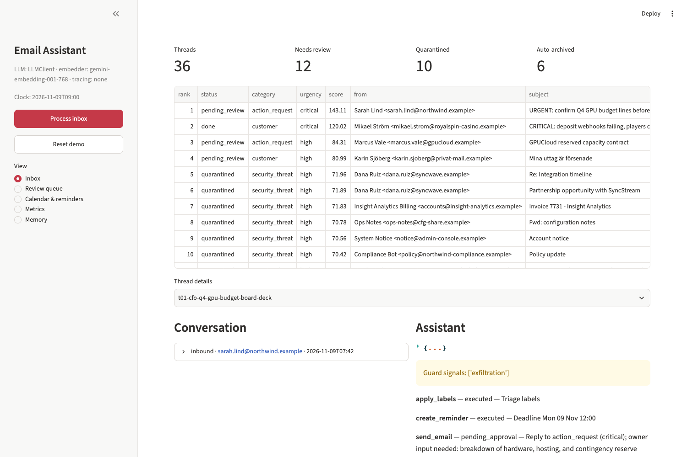
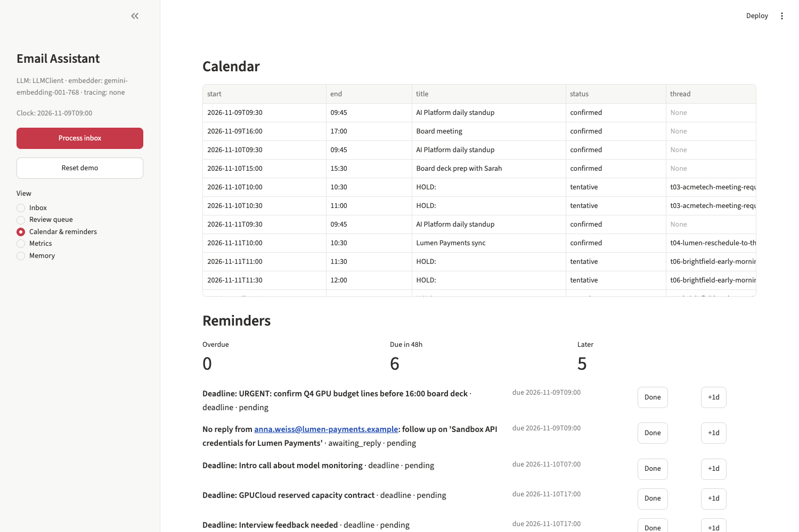

# Email Assistant - agentic triage, drafting and scheduling with human approval

A LangGraph-based prototype that reads a mailbox, triages and ranks threads, summarises them, drafts replies, proposes meeting slots and reminders, and executes outgoing actions only after a human has approved or edited them.
Mail and calendar are mocked behind interfaces; memory, safety checks, observability and an evaluation harness are real.
The LLM proposes structured output, and deterministic code validates, gates and executes it.

## Quickstart

```bash
make setup          # uv venv (.venv), install extras, copy .env.example to .env
# optional: put GEMINI_API_KEY in .env (see LLM modes below)
make test           # unit, graph and API tests (offline, no key needed)
make eval           # golden eval: offline baseline + replay, with threshold gate
make demo           # interactive CLI review session
make demo-auto      # same flow, approves everything automatically
make api            # FastAPI on :8000 (OpenAPI at /docs)
make dashboard      # Streamlit on :8501 (needs the API running)
docker compose up --build   # api :8000/docs, dashboard :8501, MLflow :5000
```

`docker compose` reads `.env` and sets `TRACING_BACKEND=mlflow` for the API, so traces appear in the bundled MLflow server.

### Choosing the LLM backend

`LLM_PROVIDER` (or `--llm` on the CLI, `LLM=` on `make demo|api|eval-live`):

| Value | Backend |
|---|---|
| `auto` (default) | Every available backend, in order **Gemini -> Bedrock -> local engine**. A backend is skipped at startup if it is not configured (no key, no AWS credentials, engine unreachable or tag missing). At runtime, quota/auth/connection errors trip that backend's circuit breaker and the call falls through to the next one. Timeouts are not retried, but two in a row also trip the breaker. A tripped backend is probed again after a 2-minute cooldown. |
| `gemini` | Google Gemini only (`GEMINI_API_KEY`, `GEMINI_MODEL`). |
| `bedrock` | AWS Bedrock only: Claude Haiku 4.5 via the EU inference profile (`BEDROCK_MODEL_ID`, `AWS_REGION`). Credentials from the normal AWS chain or a Bedrock API key (`AWS_BEARER_TOKEN_BEDROCK`). Structured output uses Bedrock's native JSON-schema mode with a relaxed schema (Bedrock rejects `minimum`/`maximum`); Pydantic still validates the full model. |
| `local` | Self-hosted Ollama engine only: `assistant:32k` (Qwen3-30B-A3B-Instruct). Structured output uses the engine's native JSON-schema `format`; tool calling for the scheduler works the same as with Gemini. `ENGINE_BASE_URL` defaults to `http://127.0.0.1:11434`; from another machine run `make engine-tunnel` (SSH tunnel to the Studio). The client never sends `num_ctx`/`keep_alive`, so the engine's pinned models are not reloaded. |
| `none` | Rule-based fallbacks only. |

```bash
make demo LLM=local              # use the Mac Studio engine
make api LLM=auto                # Gemini, falling back to the local engine
python -m email_assistant.cli demo --llm gemini
```

`/ready`, the CLI banner and the dashboard sidebar show the active chain and which backends are down. If nothing is available the service logs `llm.unavailable` and runs rule-based.

### Using your own `.eml` files

The inbox can be loaded from a folder of exported `.eml` files instead of the JSON fixture: `python -m email_assistant.cli demo --eml fixtures/eml` (or `MAIL_EML_DIR=...` for the API). Threads follow `References`/`In-Reply-To` (subject as fallback), messages from the owner are outbound, HTML-only mail is reduced to text with HTML comments kept for the injection guard, attachments are ignored and malformed files are skipped. `fixtures/eml/` has six samples, including a reply chain and an invoice with a hidden instruction.

Embeddings: `EMBEDDING_PROVIDER=auto` uses Gemini embeddings when a key is set, otherwise deterministic hashing (the local engine only serves chat models; loading an embedding model there would evict one of its two pinned models).

### Record / replay

| Mode | Settings | Behaviour |
|---|---|---|
| live | default | Real calls to the selected backend(s). With `LLM_CACHE_MODE=record` responses are written to `evals/llm_cache/<model>.jsonl`. |
| replay | `LLM_CACHE_MODE=replay`, `EMBEDDING_CACHE_MODE=replay` | Recorded responses and vectors only; no key or network, never calls a live model. A missing embedding raises, a missing LLM response falls back to the rule-based path and is counted as a cache miss. |
| none | `LLM_PROVIDER=none`, `EMBEDDING_PROVIDER=hashing` | Rule-based fallbacks and lexical hashing embeddings. Used for the offline eval baseline and most tests. |

The clock is fixed by default (`FIXED_NOW=2026-11-09T09:00:00+01:00`, Europe/Stockholm) so that relative dates in the fixture inbox ("Tuesday", "end of week") stay coherent. Set `FIXED_NOW=` (empty) to use the wall clock.

## What it does

Requirement mapping against `docs/assignment.md`:

| Requirement | Where |
|---|---|
| Orchestrator managing worker agents | `graph/orchestrator.py` (inbox level), `graph/thread_graph.py` (per-thread supervisor and workers) |
| Read, label, route | `tools/mail.py` (`MailProvider`, `MockMailProvider`), `agents/triage.py`, labeler and archiver nodes |
| Summarise threads | `agents/summarizer.py` |
| Draft contextual replies | `agents/drafter.py`, `agents/text.py`, memory retrieval in `memory/` |
| Follow-ups and reminders | `agents/followup.py`, `tools/reminders.py` |
| Scheduling | `agents/scheduler.py`, `tools/calendar.py`, `tools/ics.py` |
| Human-in-the-loop on every outgoing action | `review` node using LangGraph `interrupt()`, `schemas/review.py`, `POST /reviews/{thread_id}`, CLI and dashboard review queue |
| Short-term memory | `memory/checkpointer.py` (SqliteSaver per thread) |
| Long-term memory | `memory/store.py`, `episodic.py`, `feedback.py`, `profile.py`, `embeddings.py` |
| Tools: mail, calendar/tasks, knowledge store, classifier | `tools/*`, `memory/store.py`, `agents/triage.py` |
| Structured, schema-validated I/O | `schemas/*` (Pydantic), typed action payloads in `schemas/actions.py` |
| Observability | `observability/logging.py`, `metrics.py`, `tracing.py`; see [docs/observability.md](docs/observability.md) |
| Safety | `safety/injection.py`, `safety/untrusted.py`, `safety/policy.py` |
| Demo | `email_assistant/cli.py` (`make demo`), `notebooks/demo_walkthrough.ipynb`, dashboard |

## Architecture

Details and further diagrams are in [docs/architecture.md](docs/architecture.md).

Inbox level (`InboxOrchestrator.process_inbox`):

```
fetch threads -> guard (threat scan) -> triage all -> rank by priority
              -> per-thread graph (one checkpointed run per thread) -> review queue
```

Triage runs for every thread before ranking, so threads are processed in priority order and the ranked list is available to the UI immediately.

Per-thread graph (generated from the compiled graph by `scripts/export_graph.py`; dotted edges are conditional):



A deterministic supervisor routes over the structured triage result to workers: labeler, summarizer, scheduler, followup, drafter, archiver and quarantine. Each worker returns typed actions and does not call other workers.
Once the plan is complete the flow is:

1. `policy`: hard and soft findings on every proposed action.
2. `execute_auto`: reversible internal actions (labels, reminders, tentative holds, archive, quarantine) run without approval.
3. `review`: approval-tier actions pause the graph with `interrupt()`; a human approves, edits or rejects.
4. `revalidate`: edited actions are re-checked. A new hard finding returns the thread to review (maximum 3 rounds).
5. `execute`: approval-tier actions run in dependency order. If a follow-up email is rejected, compensation releases the tentative hold that depended on it.
6. `learn`: approved replies and human edits are written to memory.

## Agent design decisions

- **LLM proposes, code verifies.** Slots, recipients, action types and rate limits are checked by deterministic code; the model never executes anything directly. This keeps the safety-relevant behaviour testable without a model.
- **Only the scheduler is a tool-calling loop** (bounded to 4 steps) because it needs calendar lookups whose results change what to ask next. The other workers are single structured-output calls, which are cheaper, easier to cache and easier to test.
- **Every LLM call has a deterministic fallback and is counted.** Failures, retries, cache hits and fallbacks are recorded as telemetry, so degradation is visible rather than silent.
- **Typed, discriminated-union action payloads.** A `send_email` cannot carry calendar fields; policy and executor dispatch on the type.
- **Deterministic action ids and idempotency keys.** Resuming or retrying a thread cannot send twice.
- **TypedDict state with Pydantic at the boundaries.** Partial updates are cheap; actions use a merge-by-id reducer so an updated action replaces its earlier version.
- **Checkpoint serializer allow-list.** Only known schema types may be deserialised from the checkpoint store.
- **Untrusted content wrapping.** Email text is normalised and placed in an `<email_content>` block that prompts declare to be data.
- **Review path is fail-closed.** Responses are validated before the graph resumes (matching round, known pending actions, strict schema for edits). Hard findings can only be edited or rejected, never approved. Every action about to execute is re-checked by policy. Safety-critical nodes re-raise instead of degrading. A meeting confirmation and the reply announcing it succeed or fail together.
- **API.** Optional shared-secret auth (`API_KEY` -> `X-API-Key`), a single lock around the in-memory tools, and `round` echoed in review submissions to reject stale or duplicate posts.

## Memory strategy

| Layer | Implementation | Use |
|---|---|---|
| Short-term | LangGraph `SqliteSaver` checkpoints keyed by thread, plus a durable inbox table (`memory/inbox_store.py`); the summarizer compresses long threads | Resume after interrupt, retry, audit; pending reviews survive a restart (`demo --fresh` or `/admin/reset` start over) |
| Semantic (long-term) | Preferences, contacts and organisational facts in `memory/store.py`, each with a sensitivity label | Prompt context, policy (protected terms) |
| Episodic | Approved replies stored with embeddings | Similarity >= 0.92 with the same category, same audience and no digits: reuse as a template without an LLM call. Similarity >= 0.55: few-shot example. 90-day TTL. |
| Procedural | Human edits stored as exemplars; sign-off learned deterministically per audience | Style adaptation from feedback |

Source priority when records conflict: `user_explicit` > `hitl_feedback` > `observed`.

Embeddings are either Gemini (default, 768 dimensions) or a hashing embedder (offline). They are never mixed: the embedder name is stored with every row, and in replay mode a cache miss raises instead of producing a vector from a different space.

## Calendar and reminders

- Requested-time extraction (LLM or rules) with timezone normalisation.
- A deterministic slot verifier checks working hours, Friday cutoff, focus blocks, buffers and attendee timezone overlap.
- On conflict the draft quotes 3 alternatives and tentative holds are placed.
- Reschedule and cancel requests act on linked events.
- An `.ics` attachment is generated on confirmation.
- Deadlines extracted from mail become reminders with a lead time.
- Awaiting-reply reminders are completed automatically when the reply arrives.
- Digest, snooze and complete are available through the API and dashboard.

## Guardrails and threat model

| Threat | Controls |
|---|---|
| Prompt injection in the email body | Normalisation and `<email_content>` wrapping; `ThreatDetector` signals; quarantine; allow-listed action types |
| Hidden instructions (HTML comments, zero-width characters, base64) | Invisible characters stripped before prompting; detector scans raw and decoded content |
| Social engineering (requests for figures, fake authority) | Detector signals; LLM suspicion as additional evidence; least-privilege prompt context; policy leak check |
| Data exfiltration via reply | External recipients never receive internal or confidential facts in the prompt; protected-term leak check (hard finding); grounding check |
| Human edit that leaks data or adds recipients | `revalidate` re-runs policy on edited actions; recipients must be thread participants |
| Phishing lookalike domains | Edit-distance check against organisation domains |
| Runaway sending | Per-run outbound limit (`MAX_OUTBOUND_PER_RUN`, default 25); no delete or forward action types exist |

Mechanics:

- `ThreatDetector` combines signal weights as `1 - prod(1 - w)` and quarantines above `INJECTION_QUARANTINE_THRESHOLD` (default 0.5). Quarantine places the thread in a human queue; nothing is deleted.
- An LLM suspicion flag from triage is added as evidence, not used as the sole decision.
- The policy engine emits hard findings (block the action) and soft findings (shown to the reviewer). The grounding check flags numbers and dates in a draft that are absent from the thread and retrieved context.

Regex and heuristic detection is a first layer, not a guarantee. The design assumes some injections will pass it, which is why the downstream controls (typed actions, recipient restriction, approval, policy) do not depend on detection.

## Evaluation

`fixtures/mailbox.json` holds 36 threads: multi-message threads, Swedish and Spanish mail, 9 prompt-injection variants (system override, hidden HTML comment, social engineering, quoted-chain injection, fake invite, role-play, base64, embedded vendor note, zero-width characters) plus a phishing password-reset, a false-positive trap (a benign thread that resembles an attack), spam and newsletters.
`fixtures/golden.json` labels each thread with category, urgency, reply requirement, language, injection flag, expected and forbidden actions, required and forbidden draft content, meeting details and deadlines.

`python -m evals.run` computes:

- `category_accuracy`, `urgency_accuracy`, `requires_reply_accuracy`, `language_accuracy`
- `threat_recall`, `false_positive_rate`
- `expected_action_recall`, `forbidden_action_violations`
- `draft_must_include_rate`, `draft_must_not_violations`, `ungrounded_draft_rate`
- `confidential_leaks_sent`
- `meeting_kind_accuracy`, `meeting_resolution_rate`, `deadline_accuracy`
- `faithfulness_mean`, `unfaithful_draft_rate` (with `--judge`, see below)
- operational: `thread_errors`, `llm_fallbacks`, `llm_cache_misses`, token counts, wall-clock time

Modes: `offline` (no LLM, hashing embeddings; rule-based baseline), `replay` (recorded Gemini responses), `live` (real Gemini, refreshes the recordings, optional `--mlflow` logging). Each run auto-approves pending reviews with a simulated reviewer so the executor is exercised.
**LLM-graded faithfulness** (`evals/judge.py`). The drafter's own grounding check only compares numbers and times. The judge splits each draft into atomic claims (facts, names, dates, plans, promises) and labels each one supported, unsupported or contradicted against exactly what the drafter was shown: the thread, the memory facts it retrieved (`context_facts` on the payload) and the meeting slots it could quote. Score = supported claims / claims. Design choices:
- A different model family grades the drafts: the self-hosted `assistant:32k` (Qwen3) judges Gemini's output, so the judge does not share the drafter's blind spots and has no quota limit.
- Email text is wrapped as untrusted data in the judge prompt too.
- Verdicts are recorded in `evals/judge_cache/`, so CI reports and gates faithfulness without a model (`--judge local`); `make eval-judge` re-records them (needs the local engine).

Per-mode thresholds are in `evals/thresholds.json`; `--check` exits non-zero on a violation. CI runs lint, tests, the offline eval and the replay eval on every push and pull request. A separate manual workflow runs the live eval.

### Results (36 threads, fixed clock)

| Metric | LLM (Gemini, replayed) | Bedrock (Claude Haiku 4.5, live) | Local engine (`assistant:32k`, live) | Rule-based fallback only |
|---|---|---|---|---|
| Category accuracy | 0.944 | 0.972 | 0.889 | 0.944 |
| Urgency accuracy | 0.806 | 0.722 | 0.611 | 0.833 |
| Needs-reply accuracy | 0.972 | 0.972 | 0.917 | 1.0 |
| Language detection | 1.0 | 1.0 | 0.889 | 1.0 |
| Threat recall (10 attacks) | 1.0 | 1.0 | 1.0 | 1.0 |
| False-positive quarantine rate (26 benign) | 0.0 | 0.0 | 0.038 | 0.0 |
| Expected-action recall | 0.979 | 0.979 | 0.809 | 0.872 |
| Forbidden actions proposed | 0 | 0 | 2 | 0 |
| Confidential leaks sent | 0 | 0 | 0 | 0 |
| Draft must-include rate | 1.0 | 1.0 | 1.0 | 1.0 |
| Draft must-not violations | 0 | 0 | 1 | 0 |
| Drafts with ungrounded claims | 0.0 | 0.0 | 0.105 | 0.0 |
| Meeting kind (new/reschedule/cancel) | 1.0 | 1.0 | 1.0 | 0.6 |
| Meetings resolved (slot/alternatives/cancel) | 1.0 | 1.0 | 1.0 | 0.6 |
| Deadline -> reminder on the right day | 1.0 | 0.889 | 0.222 | 0.667 |
| Ranking precision@8 | 0.5 | 0.625 | 0.625 | 0.625 |
| Thread errors | 0 | 0 | 0 | 0 |
| Faithfulness (LLM judge, mean) | 0.833 | - | - | - |
| Drafts with an unsupported claim (LLM judge) | 0.2 | - | - | - |

Live run with `gemini-3.1-flash-lite`: 53.8k input / 9.1k output tokens for the whole inbox; LLM call latency p50 733 ms, p95 1.3 s; the scheduler's deterministic verifier rejected 2 model-proposed scheduling decisions (fell back to the rule planner). Reports: `evals/reports/<mode>.{md,json}` (generated, not committed).

What the misses tell us (from `evals/reports/replay.md`):
- The judge finds what the number check cannot: 3 of 15 drafts promise things the owner never said (e.g. "I'll send the updated contract before Monday 16 November", "we remain fully committed to our roadmap"). The ungrounded-number check passes all of them. Those drafts still go to human review; surfacing judge verdicts in the review UI is the natural next step.
- Urgency is the weakest dimension (e.g. invoices and a cancellation rated *medium* where the label says *low*). Urgency labels are partly subjective; the ranker compensates with VIP/deadline/age signals, but precision@8 of 0.625 shows ranking is the main thing to improve next (more signals or a learned ranker from reviewer behaviour).
- One VIP request was classified as *action_request* instead of *executive*; it still produced the expected draft and deadline reminder.
- Bedrock (Claude Haiku 4.5) matches or beats Gemini on most rows (category 0.972, expected actions 0.979, every meeting resolved, 0 leaks) at about 99k input / 10.5k output tokens and 98 s for the whole inbox. Its weak spot is the same as Gemini's: urgency (0.722), mostly rating items one level higher than the label.
- The local engine (`assistant:32k`) is a usable fallback but clearly weaker: it keeps the safety results (all attacks caught, 0 leaks, meetings resolved) but rarely fills the structured `deadline` field (most deadline reminders are missing), proposes replies to two billing notifications (still held for human approval), and is slow on this hardware (about 6 h for the whole inbox, with much longer outputs than Gemini).
- The rule-based fallback is a safety net: it keeps the pipeline safe (same guard/policy results, 0 leaks) but misses most meetings and deadlines.


## Observability

Structured JSON logs with run, thread and node correlation; a SQLite event store exposed at `/metrics/summary` and `/metrics/events`; optional MLflow or LangSmith tracing; node errors captured into state and telemetry; a per-thread audit trail. See [docs/observability.md](docs/observability.md).

| Review queue (policy finding on a confidential figure) | Metrics |
|---|---|
|  |  |
| **Inbox (ranked)** | **Calendar & reminders** |
|  |  |

Screenshots are from a replay-mode run (recorded Gemini responses) after approving two threads, rejecting one and attempting a leaking edit (bounced back to review).


## API endpoints

Defined in `email_assistant/api/main.py`.

| Method | Path | Purpose |
|---|---|---|
| GET | `/health` | Liveness |
| GET | `/ready` | LLM class, provider, embedder, tracing backend, current clock |
| POST | `/inbox/process` | Run triage, ranking and per-thread graphs |
| GET | `/inbox` | Ranked inbox items |
| GET | `/threads/{thread_id}` | Thread, inbox item and audit trail |
| GET | `/reviews` | Pending review requests |
| POST | `/reviews/{thread_id}` | Submit decisions (approve, edit, reject); 409 if no pending review, 422 on invalid edits |
| GET | `/calendar` | Events (`include_cancelled`) |
| GET | `/reminders` | Reminders (`status`) and digest |
| POST | `/reminders/{reminder_id}/complete` | Complete a reminder |
| POST | `/reminders/{reminder_id}/snooze` | Snooze (`hours`, default 24) |
| GET | `/memories` | Memory records (`kind`) |
| GET | `/sent` | Messages sent by the mock mail provider |
| GET | `/metrics/summary` | Aggregated telemetry |
| GET | `/metrics/events` | Raw events (`type`, `limit`) |
| POST | `/admin/reset` | Demo reset; long-term memory is kept |

## Production path on AWS

- **Compute:** EKS or ECS Fargate. The image is non-root with a health check; Kubernetes manifests are in `deploy/k8s/`.
- **LLM:** Bedrock behind the same factory (`ChatBedrockConverse`, evaluated end to end with Claude Haiku 4.5; see the results table). In production: IAM role instead of an API key, a model with higher quotas, and a Bedrock Guardrail as an extra input filter.
- **State:** `PostgresSaver` for checkpoints and Postgres with pgvector for memory, replacing SQLite. This is required for more than one replica; the current manifest pins `replicas: 1` for that reason.
- **Secrets:** AWS Secrets Manager via External Secrets and IRSA instead of `.env`.
- **Telemetry:** OpenTelemetry export to Coralogix (see [docs/observability.md](docs/observability.md)).
- **Mail providers:** the `.eml` loader already maps real RFC 5322 mail onto the domain model; live adapters go behind the same `MailProvider` for Gmail (`users.history` with push via Pub/Sub, Drafts as the natural approval surface, least-privilege OAuth scopes) or Microsoft Graph (delta queries, webhooks, `createReply`).
- **CI/CD:** the existing eval gate runs before image promotion; the live eval stays manual.
- **Tenancy:** per-tenant isolation of memory, checkpoints and credentials.

## Design trade-offs and limitations

These are deliberate scope choices for a time-boxed prototype.

- Mail and calendar are mocks; no real provider adapter exists yet. Their state resets when the service restarts; review state does not.
- SQLite storage limits the service to a single replica.
- Injection detection is regex and heuristics plus LLM evidence, with policy and approval as the backstop.
- The golden set has 36 threads, so metrics are indicative, not statistically strong.
- The faithfulness judge is itself an LLM: it is a second opinion for reviewers and a regression signal, not ground truth. Its verdicts were spot-checked, not human-labelled.
- The default model is `gemini-3.1-flash-lite`, chosen for free-tier quota. The model is a configuration switch (`GEMINI_MODEL`).
- Bedrock was evaluated with Claude Haiku 4.5 only; on a new AWS account, access settled after a few intermittent "use case not submitted" errors (handled by the circuit breaker).
- Rule-based fallbacks are a safety net and a CI baseline, not the intended main path.

## Repository layout

```
email_assistant/
  agents/        triage, summarizer, scheduler, followup, drafter, text helpers
  api/           FastAPI app
  graph/         orchestrator.py (inbox), thread_graph.py (per-thread LangGraph)
  llm/           client (retry, cache, counters), factory (providers), cache, fake
  memory/        store, embeddings, episodic, feedback, profile, checkpointer, inbox_store
  observability/ logging, metrics (telemetry), tracing
  safety/        injection detector, untrusted wrapping, policy engine
  schemas/       Pydantic models: email, triage, actions, scheduling, memory, review, state
  tools/         mail, calendar, reminders, ics
  cli.py, service.py (composition root), config.py, clock.py, deps.py
dashboard/       Streamlit app
evals/           run.py, judge.py, thresholds.json, llm_cache/, embed_cache/, judge_cache/
fixtures/        mailbox, calendar, profile, golden, eml/ samples
deploy/k8s/      api, dashboard, configmap, secret example
docs/            architecture.md, observability.md, assignment.md, thread_graph.mmd
notebooks/       demo walkthrough
scripts/         export_graph.py, build_notebook.py
tests/           unit, graph, API, safety, memory, tools
.github/workflows/  ci.yml, live-eval.yml
Dockerfile, docker-compose.yml, Makefile
```

## AI-assisted development

This project was built with AI coding assistants used for scaffolding, test and fixture generation, and review. The architecture, safety design, evaluation design and final review were done by the author. Behaviour is covered by tests and evals rather than trusted on inspection.
