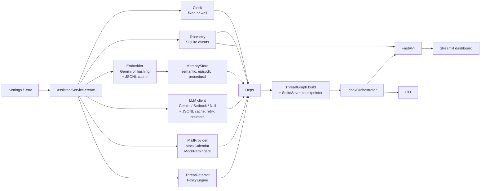
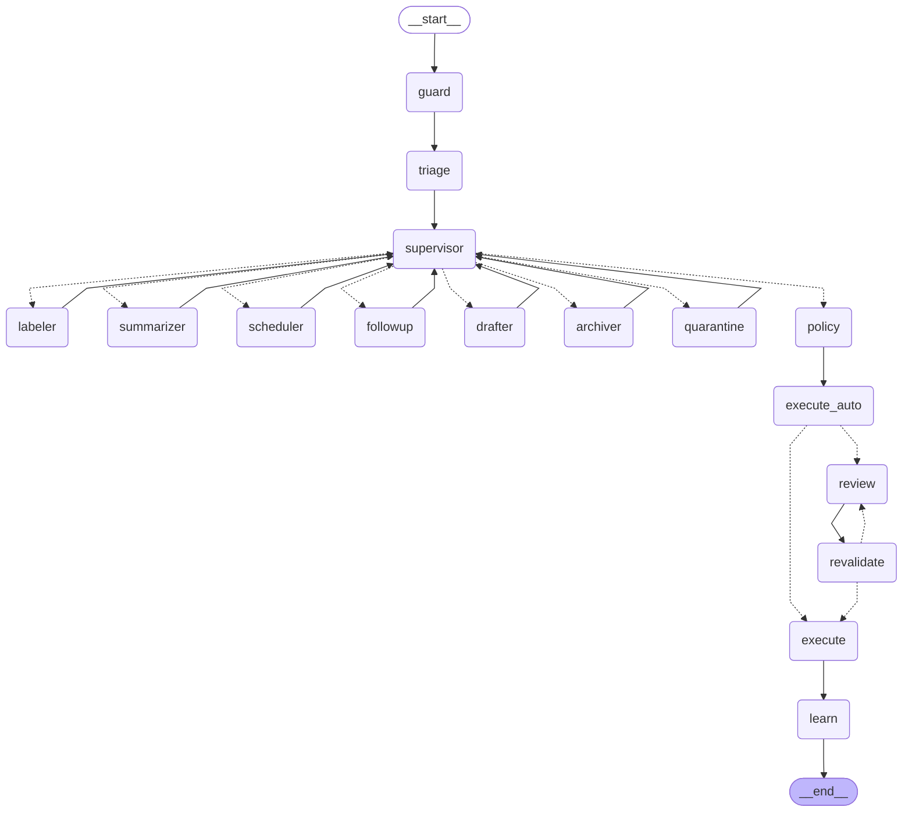
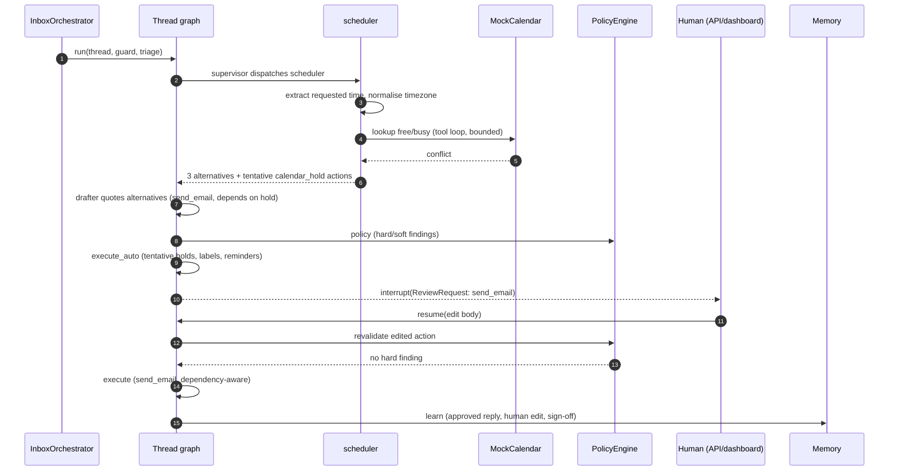
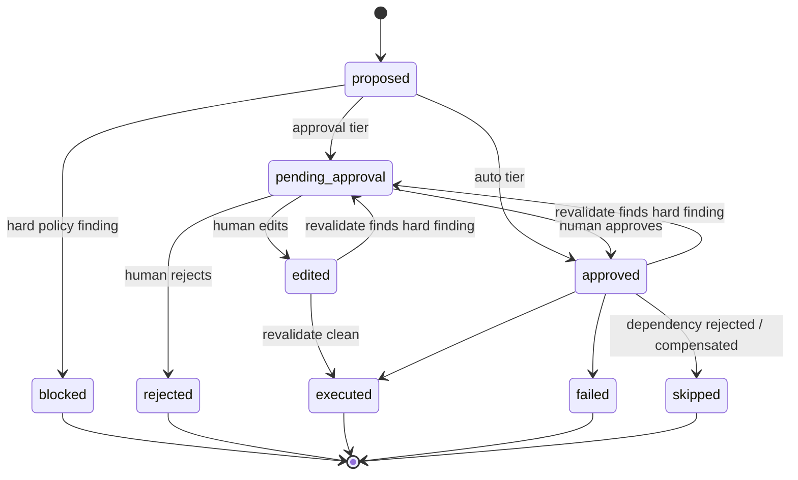

# Architecture

## Service composition

`AssistantService.create` (`email_assistant/service.py`) is the single composition root used by the API, CLI, notebook, eval runner and tests.

`Deps` is a plain container passed to the graph and workers. Nothing reads global state, so tests inject fakes (`llm`, `embedder`, `clock`, `mail`) through `create(...)`. `ephemeral=True` moves every database to `:memory:`; the eval runner uses it.

## Inbox orchestrator

`InboxOrchestrator.process_inbox`:

1. List threads not yet processed.
2. For inbound replies, resolve awaiting-reply reminders for that thread.
3. For each thread: `ThreatDetector.assess`, then the triage agent (structured classification, optionally merged with LLM suspicion).
4. Rank by a priority score (`priority_score`) and assign ranks.
5. Run the per-thread graph in rank order with a `thread_id`-keyed checkpoint.
6. Threads that stop at `interrupt()` appear in the review queue (`pending_reviews`); `submit_review` resumes them.

## Per-thread graph

Generated from the compiled graph (`scripts/export_graph.py`).

Routing is deterministic: the supervisor reads the triage result and builds a plan (`plan`, `completed` in state), then dispatches the next worker until the plan is empty, then goes to `policy`. Every node is wrapped by `traced_node`. For workers, an exception is appended to `state.errors`, the node is marked completed and the thread continues in degraded form. The safety-critical nodes (`policy`, `execute_auto`, `review`, `revalidate`, `execute`) fail closed: the exception aborts the run, so nothing unvalidated can reach execution.

`review` calls `interrupt()` with a `ReviewRequest`; the checkpoint holds the state until `Command(resume=ReviewResponse)` arrives. Before resuming, the orchestrator validates the response: the review round must match, every action id must be pending, edits must pass the strict payload schema (unknown fields and naive datetimes are rejected), and an action with hard findings cannot be approved, only edited or rejected. `revalidate` is the single gate before `execute`: it re-runs policy on every approved or edited approval-tier action; a hard finding routes back to `review` (after 3 rounds the action is blocked). A meeting confirmation and the email announcing it are all-or-nothing.

## Sequence: meeting request with conflict

If the reviewer rejects the email instead, `execute` runs the compensation path and releases the tentative holds that depended on it. If the edit introduces a hard finding (for example a recipient outside the thread), `revalidate` returns the thread to `review`.

## State schema

`ThreadState` (`schemas/state.py`) is a `TypedDict(total=False)`; node updates are partial dicts.

| Field | Type | Reducer | Purpose |
|---|---|---|---|
| `thread_id` | str | last write | Checkpoint key |
| `thread` | `EmailThread` | last write | Input thread |
| `guard` | `GuardResult` | last write | Risk score, signals, threat type |
| `triage` | `TriageResult` | last write | Category, urgency, reply need, language, labels |
| `summary` | `ThreadSummary` | last write | Thread summary |
| `plan` | list[str] | last write | Workers still to run |
| `completed` | list[str] | `operator.add` | Workers finished |
| `scheduling` | `SchedulingDecision` | last write | Requested time, verdict, alternatives |
| `actions` | dict[id, `ProposedAction`] | `merge_actions` (merge by id) | All proposed actions and statuses |
| `review_round` | int | last write | Review/revalidate counter |
| `audit` | list[dict] | `operator.add` | Append-only trail |
| `errors` | list[str] | `operator.add` | Captured node errors |

Action payloads are a discriminated union over `ActionType`: `send_email`, `calendar_hold`, `calendar_confirm`, `calendar_update`, `calendar_cancel`, `create_reminder`, `apply_labels`, `archive`, `quarantine`. Each action has a `RiskTier` (`auto` or `approval`), a deterministic id and an idempotency key.

## Action lifecycle

Statuses are defined in `ActionStatus`: `proposed`, `blocked`, `pending_approval`, `approved`, `edited`, `rejected`, `executed`, `failed`, `skipped`.

## Safety placement

| Stage | Control |
|---|---|
| Before triage | `ThreatDetector.assess` on raw thread; quarantine above threshold |
| Prompt construction | `untrusted.wrap` (normalise, strip role tags, delimit); least-privilege context by recipient audience |
| After worker output | Pydantic validation; typed payloads |
| `policy` / `revalidate` | Allow-listed action types, recipients within thread participants, protected-term leak check, attendee check, rate limit, grounding check |
| `execute` | Idempotency keys; dependency order; compensation |
